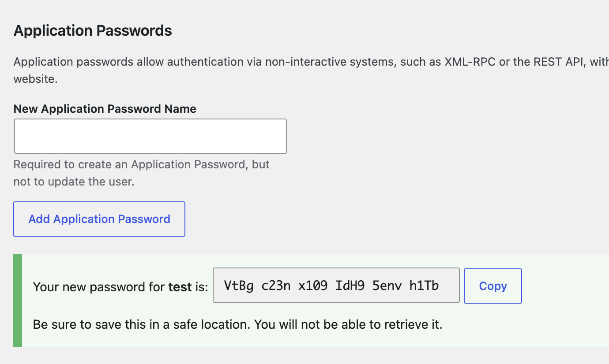

# Your WP MCP: 3 Steps

You need: a Mac, Linux or Windows machine (Command Prompt, PowerShell or WSL all work), Node 22.14 or newer, git, Claude
Code, and a WP site you can afford to break (yours or a staging copy, not a client's live site). The site must use
HTTPS.

No suitable site, or yours blocks app passwords? Make a free throwaway WP site (InstaWP or similar) and use that.

Check first. Both must print a version, and node must be v22.14 or higher:

```bash
node -v
git --version
```

No node? Install the current LTS from nodejs.org, then reopen the terminal.

---

## Step 1: Make the key (WP admin, 3 minutes)

1. Users, Add New. Username `ai-editor`. Role **Editor**. Never Administrator. Use a strong password you won't use
   again.
2. Users, edit `ai-editor`, scroll to **Application Passwords**. Name it `Claude Code`. Click Add.
3. Click **Add Application Password**. A green box appears. Click **Copy** now, because WP shows it only once.



**You should see exactly this:**

- A green box: "Your new password for **ai-editor** is:" followed by six groups of four letters and numbers
- The name in the box is `ai-editor`, not your own admin name
- A Copy button, and "You will not be able to retrieve it" underneath

Anything different is a problem:

| You see                                                | Meaning and fix                                                                                                                                                                                     |
| ------------------------------------------------------ | --------------------------------------------------------------------------------------------------------------------------------------------------------------------------------------------------- |
| No "Application Passwords" section on the profile page | The site is not on HTTPS, or a security plugin or the host turned it off. Try a throwaway site                                                                                                      |
| A warning or error notice instead of the green box     | Same causes. Read the notice, then try a throwaway site                                                                                                                                             |
| The box names a different user                         | You are on the wrong profile. Go to Users, edit `ai-editor`, and add it there                                                                                                                       |
| The password is not six groups of four                 | You copied something else, such as a login password. Add a new application password and copy the green box                                                                                          |
| The green box is empty, or Copy copies nothing         | WP redirected the request, so no password was made. In Settings, General, make WordPress Address and Site Address match the address in your browser exactly (https, www or not), then add a new one |

Done when the green box shows a password for `ai-editor` and you have copied it. Setup in Step 3 tests it for you.

---

## Step 2: Build the server (about 2 minutes)

Windows: first run `cd %USERPROFILE%` (Command Prompt) or `cd ~` (PowerShell), so the folder is not created inside
`C:\WINDOWS\system32`.

```bash
git clone https://github.com/clark-mackey/mcp-wordpress.git
cd mcp-wordpress
npm ci
npm run build
```

Done when the build finishes without an error.

---

## Step 3: Connect Claude and lock it (about 3 minutes)

Run this yourself in your own terminal window, inside the `mcp-wordpress` folder. Claude cannot run it for you: its
command runner cannot take the hidden password, and the password should never pass through chat.

```bash
npm run connect
```

It asks for three things: your site URL, the username (press Enter for `ai-editor`), and the application password (paste
it; nothing shows as you type, that is normal). Then it:

1. Tests the login and **refuses an Administrator account**
2. Checks everything that could fail (your Claude settings file, an existing `wp` entry) **before it writes anything**
3. Saves the login to `.env` (owner-only file inside the `mcp-wordpress` folder)
4. Adds 13 tools to Claude's deny list (all deletes, user and app-password tools, site settings), **before** the server
   is registered
5. Registers the server with Claude Code as `wp`
6. Starts the server and calls WordPress as your `ai-editor` user to confirm it works

Then quit and reopen Claude Code, and run `/mcp`. `wp` should show as connected.

**You are done when all three work:**

1. "List my 5 most recent pages and when each was last modified." Claude returns real pages.
2. "Create a draft page called MCP test, then delete it." The create works, the delete is blocked.
3. "Change the text of the MCP test page to something worse. Then restore the earlier version." Both succeed, and WP
   admin shows the change in Revisions.

The test page keeps all of this away from your real content. Trash it from WP admin when you are done.

In Claude's normal permission mode, every tool not on the deny list asks before it runs. Reads can be set to "always
allow" the first time Claude asks. Auto mode, skip-permissions and broad allow rules such as `mcp__wp__*` turn those
prompts off, so leave them off for real sites.

Two things to know while you work:

- Pages with scripts or embeds (a HubSpot or Calendly widget, `onclick` buttons) cannot be edited through the tool. If
  Claude offers to "remove the unsafe part", say no and make that edit in WP admin. Schema blocks
  (`application/ld+json`) are fine.
- Setup turns the page cache off (`DISABLE_CACHE=true` in `.env`), so Claude always reads the current page.

### What is stored where

| What                                                | Where                                                                                                                                           |
| --------------------------------------------------- | ----------------------------------------------------------------------------------------------------------------------------------------------- |
| Site URL, username, app password                    | `mcp-wordpress/.env` on your laptop (owner-only). The only place the password is stored                                                         |
| Claude Code registration                            | `~/.claude.json`: the command only, no password                                                                                                 |
| Blocked tools                                       | `~/.claude/settings.json` under `permissions.deny`. Your old file is copied to `settings.json.bak-<time>` first                                 |
| Login header fallback (only on hosts that strip it) | `wp-content/mu-plugins/mcp-wordpress-auth.php` on the site, and `WORDPRESS_AUTH_HEADER_FALLBACK=true` in `.env`. Delete the file to turn it off |

---

## If it doesn't work

| You see                                        | Fix                                                                                                                                                                                                                                                                                                                                                                                |
| ---------------------------------------------- | ---------------------------------------------------------------------------------------------------------------------------------------------------------------------------------------------------------------------------------------------------------------------------------------------------------------------------------------------------------------------------------- |
| `node -v` is below 22.14                       | Install current LTS from nodejs.org                                                                                                                                                                                                                                                                                                                                                |
| No Application Passwords section in WP         | Site needs HTTPS, or a security plugin turned it off. Try a throwaway site                                                                                                                                                                                                                                                                                                         |
| Setup says "username or app password is wrong" | Use the WP username (not the display name). Paste the app password again                                                                                                                                                                                                                                                                                                           |
| Setup says "never saw the login"               | The host strips the login header. Easiest fix: copy `wordpress/mu-plugins/mcp-wordpress-auth.php` from the `mcp-wordpress` folder into the site's `wp-content/mu-plugins/` folder (create it if missing), then run setup again; it detects the plugin and turns it on. Or add `CGIPassAuth On` at the top of `.htaccess`, or ask the host to pass the Authorization header through |
| Setup says "with a web page, not WordPress"    | A firewall, bot filter or staging password blocks the API. Ask the host to allow `/wp-json/`, or try a throwaway site                                                                                                                                                                                                                                                              |
| Setup says "REST API was not found"            | Check the Site URL. Then WP Settings, Permalinks, choose Post name                                                                                                                                                                                                                                                                                                                 |
| Setup says "redirected"                        | Use the final address it prints as the Site URL                                                                                                                                                                                                                                                                                                                                    |
| Setup says Administrator                       | Make an Editor user and use that one                                                                                                                                                                                                                                                                                                                                               |
| `/mcp` shows `wp` failed                       | In the `mcp-wordpress` folder run `npm run status` and read the first error                                                                                                                                                                                                                                                                                                        |
| Claude can't see the tools                     | Quit and reopen Claude Code                                                                                                                                                                                                                                                                                                                                                        |

Run `npm run connect -- --dry-run` (the `--` matters) to see what it would do without changing anything. Run it again
any time: it updates the login in `.env` (keeping your other settings there), does not duplicate rules, and replaces its
own earlier `wp` entry. It will not overwrite a different server that is already named `wp`: use `--name <other-name>`
instead. Old copies of `.env` and `settings.json` are kept next to the originals as `.bak-<time>` (owner-only; delete
them when you are done).

### Doing Step 3 by hand

Only if the script cannot run. In the `mcp-wordpress` folder:

```bash
npm run setup
claude mcp add wp --scope user -- node "$(pwd)/bin/mcp-wordpress.js"
```

On Windows, replace `"$(pwd)/bin/mcp-wordpress.js"` with `"%cd%\bin\mcp-wordpress.js"` (Command Prompt) or
`"$PWD\bin\mcp-wordpress.js"` (PowerShell).

Then in Claude Code, ask it to merge the 13 `mcp__wp__...` deny rules listed in `bin/connect.js` (`DENIED_TOOLS`) into
the `permissions.deny` list in `~/.claude/settings.json`, keeping everything already there.
